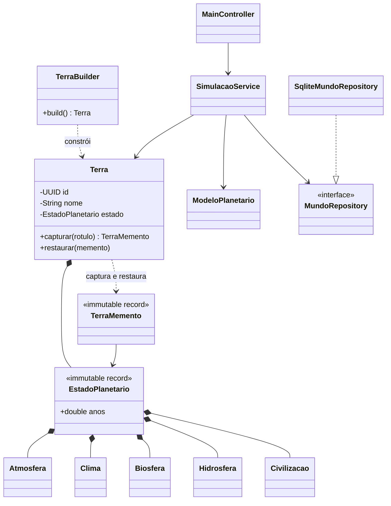
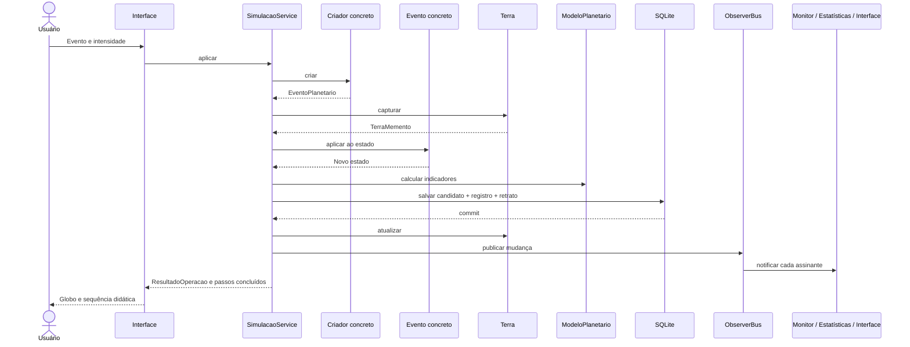

# Arquitetura implementada

O domínio não conhece JavaFX, JDBC ou o modo de interface. Records compõem o estado imutável. `Terra` mantém identidade, nome e o estado atual; é o originador do Memento. `SimulacaoService` coordena casos de uso e é o caretaker, usando `MundoRepository` para armazenar os retratos.

Para uma alteração, o serviço captura o estado anterior e prepara um candidato separado. Eventos e evolução temporal produzem novos valores. Indicadores são derivados do candidato. SQLite confirma estado, registro e retrato em uma transação. Somente depois a Terra viva é atualizada e os observadores são notificados. Falha de persistência não altera a Terra exibida nem gera notificações de sucesso.

`ObserverBus` tem assinantes removíveis e isola falhas individuais. `AlertaObserver` produz alertas por mundo; `EstatisticasObserver` acompanha extremos e quantidade de alterações durante a sessão. A interface também é assinante. Alertas e estatísticas são projeções de sessão, fora do estado planetário persistente.

A interface executa banco e casos de uso numa fila de trabalho e renderiza na thread JavaFX. Apresentação projeta `Passo` de operações já concluídas, com linguagem natural e comparação de estados imutáveis. Escolher o modo não interfere nos cálculos.

## Classes

## Fluxo real de evento

## SQLite

Schema versionado por `PRAGMA user_version`; migration `src/main/resources/db/migrations/V001__mundos.sql`. Tabelas `mundos`, `eventos` e `snapshots`, chaves estrangeiras e exclusão em cascata. Mundo e snapshot guardam todos os componentes em colunas. Valores externos usam parâmetros JDBC. `TransacaoSqlite` trata commit, rollback e falhas de autocommit; conexão serializada e tempo limite para bloqueios.

Não há física por pixel, engine gráfico próprio, processos remotos ou segundo motor didático.
