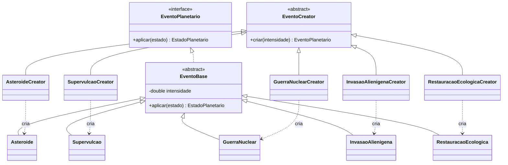
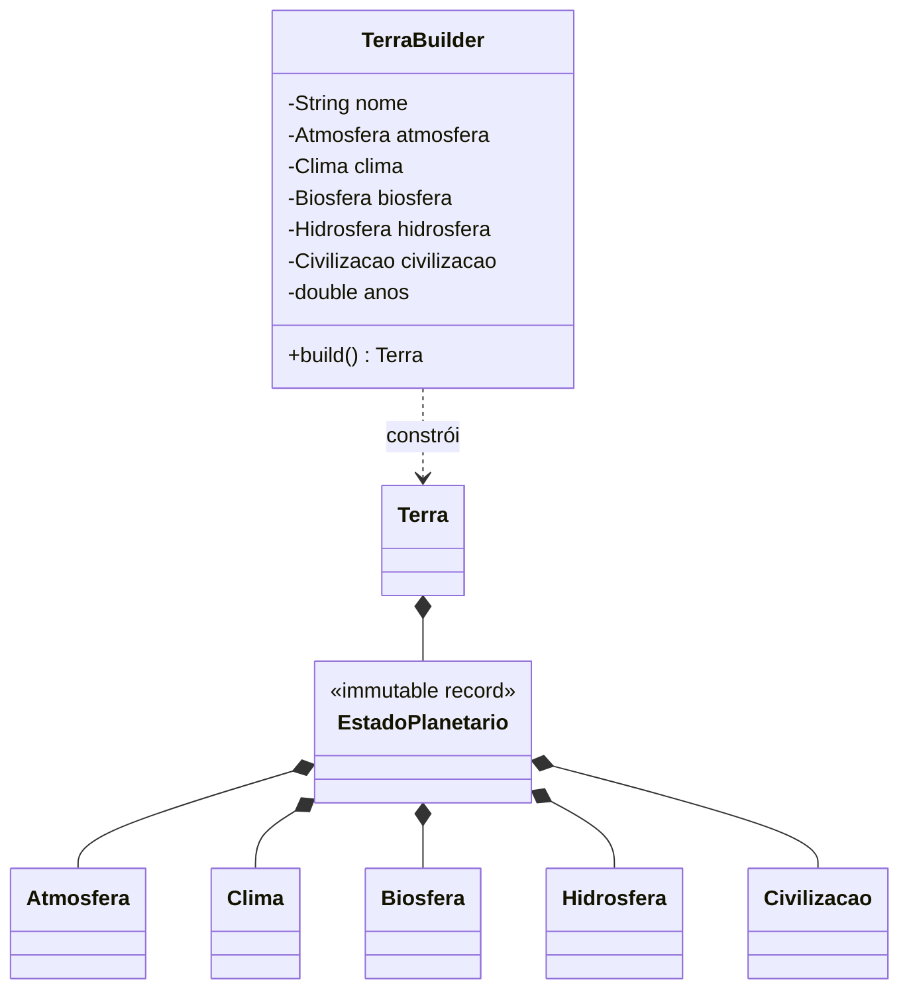
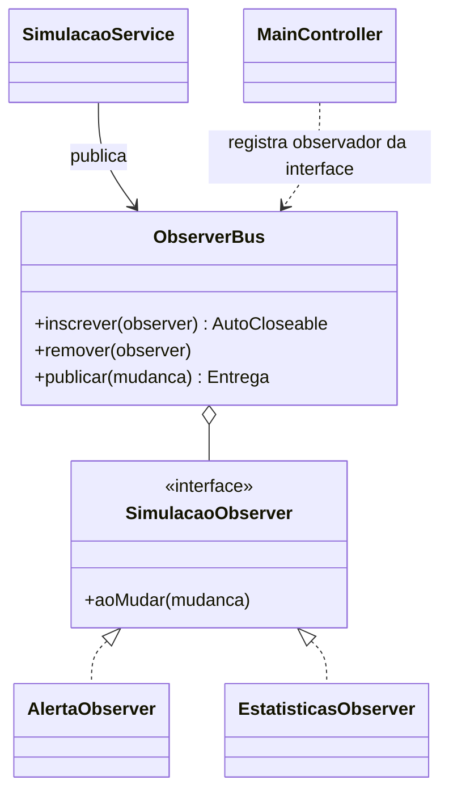
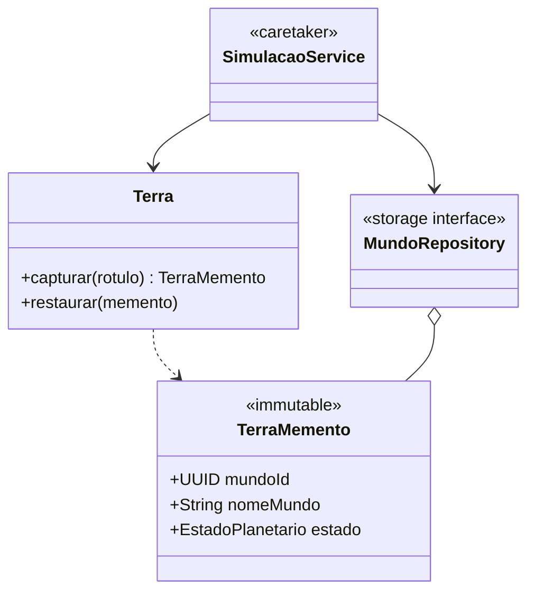

# Quatro padrões no ProjektTellus

## Factory Method

`events/EventoCreator` declara `criar`. Cinco criadores concretos (`AsteroideCreator`, `SupervulcaoCreator`, `GuerraNuclearCreator`, `InvasaoAlienigenaCreator`, `RestauracaoEcologicaCreator`) sobrescrevem o método, produzindo classes distintas que implementam `EventoPlanetario`. O serviço usa o contrato comum, sem fábrica estática com switch.

**Demonstrar:** escolher evento e intensidade e aplicar. A trilha registra o evento realmente criado, captura do estado anterior e seus efeitos ambientais.

## Builder

`domain/TerraBuilder` oferece parâmetros opcionais e defaults coerentes para os cinco componentes e tempo. `build` reúne valores imutáveis, valida o cenário e atribui uma nova identidade a `Terra`. Componentes validam limites nos construtores. Gases inconsistentes e água+gelo acima do total são rejeitados.

**Demonstrar:** criar mundo, personalizar condições iniciais e confirmar. A trilha mostra componentes reunidos, validação e construção concluída.

## Observer

`patterns/observer/ObserverBus` publica `MudancaPlanetaria` para `SimulacaoObserver`. `AlertaObserver` avalia riscos; `EstatisticasObserver` mantém extremos e contagem por mundo; a interface recebe mudanças para atualizar o planeta. O serviço não conhece telas. Assinantes podem ser removidos e suas falhas são isoladas e registradas sem simular entrega bem-sucedida.

**Demonstrar:** aplicar evento ou avançar tempo. Cada passo “Sistema notificado” corresponde a um assinante que concluiu seu callback real. A renderização ocorre na thread JavaFX após a entrega. A apresentação reproduz uma operação já concluída.

## Memento

`domain/Terra` é o **originador**: captura e restaura `patterns/memento/TerraMemento`. O record guarda identidade do mundo, nome original, instante, todos os componentes e tempo; o grafo é imutável. `SimulacaoService` é o **caretaker**: captura checkpoints e coordena restauração; o repositório armazena o histórico de retratos. Captura em memória existe antes da gravação. O padrão não depende de JSON.

Retrato de outra Terra é rejeitado. Duplicar cria identidade e retrato próprios. Restaurar preserva também o estado substituído e recupera nome/tempo/componentes completos.

**Demonstrar:** capturar, provocar catástrofe, selecionar retrato e restaurar. Comparar antes/depois e carregar outro mundo para mostrar seu isolamento.

POO: composição de componentes, encapsulamento do estado atual, herança na família real de eventos/criadores, polimorfismo em eventos/observadores/repositório e dependência de interfaces. Records reduzem boilerplate sem compartilhar mutabilidade.
