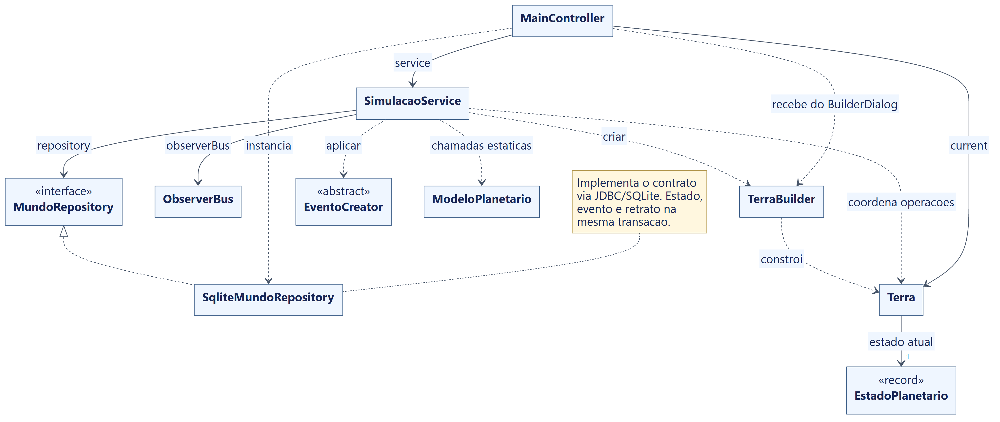
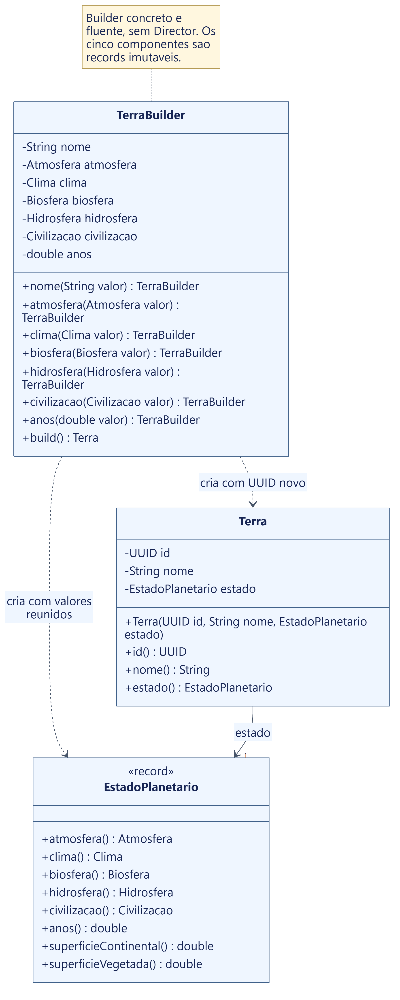
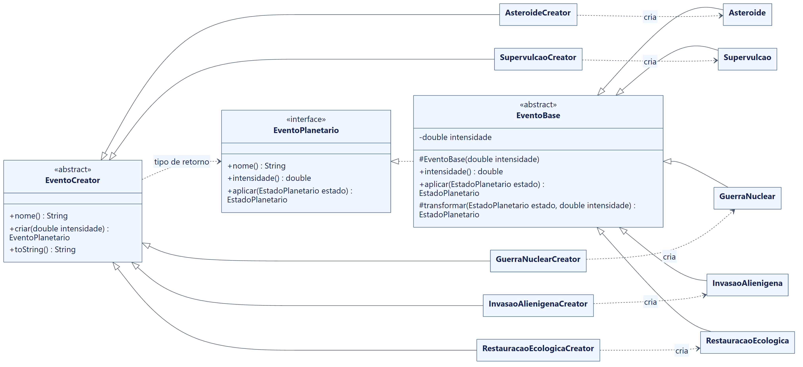
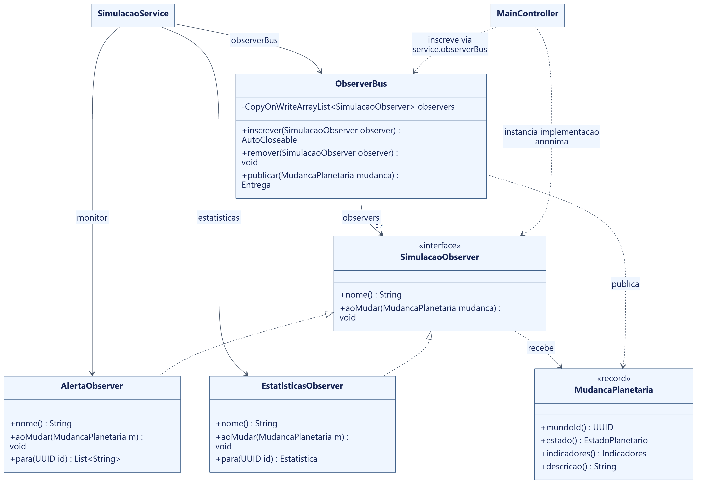
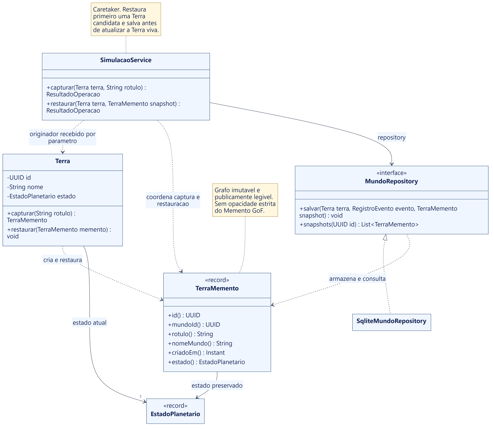
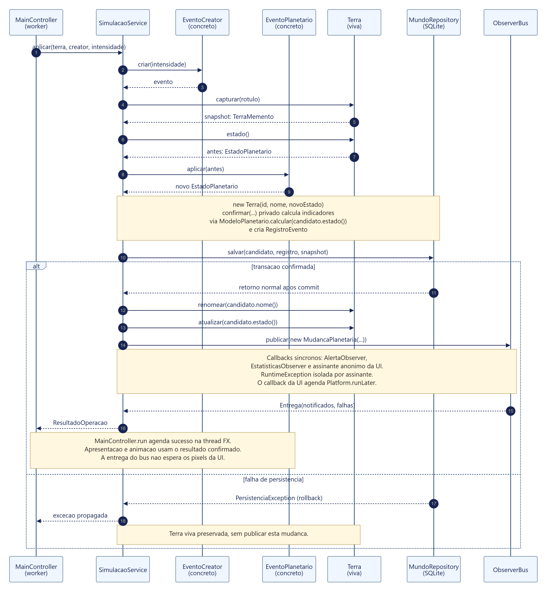
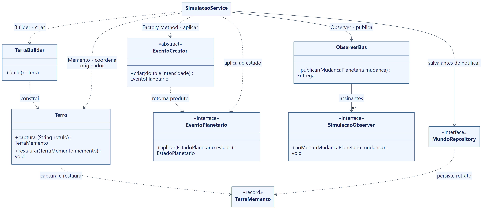

# UML oficial — ProjektTellus

Visões da arquitetura **implementada** em `src/main/java/com/projekttellus`, independentes da apresentação acadêmica. Cada diagrama tem fonte Mermaid editável, PNG em alta resolução e SVG vetorial. As visões são complementares: omitem membros fora de seu assunto, sem pretender listar todas as classes auxiliares da interface.

| Consulta | Fonte | Imagens |
|---|---|---|
| [1. Arquitetura geral](#1-arquitetura-geral) | [Mermaid](01-arquitetura.mmd) | [PNG](01-arquitetura.png) · [SVG](01-arquitetura.svg) |
| [2. Builder](#2-builder) | [Mermaid](02-builder.mmd) | [PNG](02-builder.png) · [SVG](02-builder.svg) |
| [3. Factory Method](#3-factory-method) | [Mermaid](03-factory-method.mmd) | [PNG](03-factory-method.png) · [SVG](03-factory-method.svg) |
| [4. Observer](#4-observer) | [Mermaid](04-observer.mmd) | [PNG](04-observer.png) · [SVG](04-observer.svg) |
| [5. Memento](#5-memento) | [Mermaid](05-memento.mmd) | [PNG](05-memento.png) · [SVG](05-memento.svg) |
| [6. Sequência de aplicação de eventos](#6-sequência-de-aplicação-de-eventos) | [Mermaid](06-sequencia-eventos.mmd) | [PNG](06-sequencia-eventos.png) · [SVG](06-sequencia-eventos.svg) |
| [7. Integração dos quatro padrões](#7-integração-dos-quatro-padrões) | [Mermaid](07-integracao-padroes.mmd) | [PNG](07-integracao-padroes.png) · [SVG](07-integracao-padroes.svg) |

Os PNGs aparecem diretamente nesta página, inclusive quando o GitHub não executa Mermaid. Para ampliar, abra o PNG ou o SVG de cada seção. A resolução de exportação é 3×; a página pode exigir rolagem vertical em telas 1366×768. O SVG mantém a nitidez em qualquer ampliação.

## Convenções de leitura

- `+` público, `-` privado, `#` protegido; operações abstratas em itálico e estáticas sublinhadas (quando exibidas).
- Linha contínua com triângulo vazio: **herança**; linha tracejada com triângulo vazio: **realização de interface**.
- Seta contínua simples: **associação navegável**, sustentada por referência armazenada. Seta tracejada simples: **dependência**, como parâmetro, retorno, criação ou chamada estática.
- `1` indica referência obrigatória; `0..*`, uma coleção possivelmente vazia. A multiplicidade da extremidade oposta foi omitida quando não há restrição explícita no código.
- `«record»` identifica um record Java, não um estereótipo de padrão GoF. Seus componentes têm campos **privados e finais**, construtor canônico público e accessors públicos, como `estado()`. Os diagramas exibem os accessors, não atributos públicos fictícios. Membros gerados (`equals`, `hashCode`, etc.) foram omitidos.
- Classes concretas do projeto são `final`, incluindo os cinco criadores e os cinco produtos. No Factory Method, `EventoBase.aplicar`, `EventoBase.intensidade` e `EventoCreator.toString` também são `final`; esse modificador Java não é desenhado pelo Mermaid.
- Não há losangos de composição ou agregação nas visões oficiais. Records e estados podem ser compartilhados sem compartilhar mutabilidade; assinantes são inscritos e removidos por referência.

## 1. Arquitetura geral



`MainController` mantém a sessão (`service`) e a `Terra` selecionada (`current`). Cria o repositório SQLite na inicialização e recebe um `TerraBuilder` do diálogo. `SimulacaoService` guarda o contrato `MundoRepository` e o `ObserverBus`; recebe mundos, builders e criadores por parâmetro. `SqliteMundoRepository` **implementa** a interface do repositório. O serviço chama os métodos **estáticos** de `ModeloPlanetario`, sem manter uma instância do motor.

`Terra` guarda identidade, nome e a referência substituível ao estado atual. O domínio não depende de JavaFX ou JDBC. A interface executa os casos de uso em seu executor de trabalho e agenda a renderização na thread JavaFX. `PlanetView`, `PlanetEventAnimator` e `PresentationPane` projetam o resultado confirmado; não constituem um segundo motor de simulação.

Código: [MainController](../../src/main/java/com/projekttellus/ui/MainController.java), [SimulacaoService](../../src/main/java/com/projekttellus/application/SimulacaoService.java), [MundoRepository](../../src/main/java/com/projekttellus/persistence/MundoRepository.java), [SqliteMundoRepository](../../src/main/java/com/projekttellus/persistence/SqliteMundoRepository.java), [ModeloPlanetario](../../src/main/java/com/projekttellus/simulation/ModeloPlanetario.java).

## 2. Builder



`TerraBuilder` fornece nome, cinco componentes e anos, com valores iniciais padrão. Cada operação fluente retorna o próprio builder. `build()` cria um `EstadoPlanetario` e uma `Terra` com UUID novo; os construtores do domínio validam os valores. Não existe `Director` nem interface abstrata de builder no projeto.

Os tipos abaixo são records imutáveis, referenciados tanto pelo builder quanto pelo estado construído. Essa relação aparece nos tipos dos membros; caixas adicionais foram omitidas para manter a leitura.

| Componente de `EstadoPlanetario` | Componentes do record Java |
|---|---|
| `Atmosfera atmosfera` | `double oxigenio, nitrogenio, co2, helio, pressao` |
| `Clima clima` | `double temperatura, aerossol, radiacao` |
| `Biosfera biosfera` | `double vegetacao` |
| `Hidrosfera hidrosfera` | `double agua, gelo` |
| `Civilizacao civilizacao` | `long populacao` |
| `double anos` | Valor escalar do tempo, sem classe intermediária |

`Terra.id` é `private final`; `nome` e `estado` são privados e mutáveis. `EstadoPlanetario` expõe também as funções derivadas `superficieContinental()` e `superficieVegetada()`.

Código: [TerraBuilder](../../src/main/java/com/projekttellus/domain/TerraBuilder.java), [Terra](../../src/main/java/com/projekttellus/domain/Terra.java), [EstadoPlanetario](../../src/main/java/com/projekttellus/domain/EstadoPlanetario.java), [BuilderDialog](../../src/main/java/com/projekttellus/ui/BuilderDialog.java).

## 3. Factory Method



`EventoCreator` declara `nome()` e `criar(double intensidade)` abstratos. Cada criador concreto sobrescreve ambos como públicos; `criar` retorna **`EventoPlanetario`**, mesmo ao instanciar um produto específico. Esses overrides foram omitidos das cinco caixas concretas para evitar repetição.

| Criador concreto | Produto instanciado em `criar(double intensidade)` |
|---|---|
| `AsteroideCreator` | `new Asteroide(intensidade)` |
| `SupervulcaoCreator` | `new Supervulcao(intensidade)` |
| `GuerraNuclearCreator` | `new GuerraNuclear(intensidade)` |
| `InvasaoAlienigenaCreator` | `new InvasaoAlienigena(intensidade)` |
| `RestauracaoEcologicaCreator` | `new RestauracaoEcologica(intensidade)` |

`EventoBase` **implementa** `EventoPlanetario`. Os cinco produtos **estendem** `EventoBase`; não realizam a interface diretamente. Cada produto declara construtor público `(double intensidade)`, `public String nome()` e `protected EstadoPlanetario transformar(EstadoPlanetario e, double i)`. A base valida intensidade entre 0 e 1 e implementa `aplicar`: intensidade zero devolve o próprio estado; nos demais casos chama `transformar`. A operação produz um estado, sem alterar a `Terra` viva.

Código: [família de eventos e criadores](../../src/main/java/com/projekttellus/events), [EventoCreator](../../src/main/java/com/projekttellus/events/EventoCreator.java), [EventoPlanetario](../../src/main/java/com/projekttellus/events/EventoPlanetario.java), [EventoBase](../../src/main/java/com/projekttellus/events/EventoBase.java).

## 4. Observer



`SimulacaoService` instancia e inscreve `AlertaObserver` e `EstatisticasObserver`. O bus mantém referências numa `CopyOnWriteArrayList<SimulacaoObserver>`; `inscrever` retorna um `AutoCloseable` para cancelar a inscrição. A relação com assinantes é uma associação, sem posse exclusiva.

`MainController` **não implementa** `SimulacaoObserver`: ele instancia uma implementação anônima e guarda o cancelamento em `subscription`. Seu callback agenda `Platform.runLater`; concluir o callback não significa que a tela já foi desenhada. A realização da interface por esse objeto anônimo é descrita aqui, sem inventar uma classe Java nomeada no diagrama.

`publicar` é síncrono e retorna o record aninhado `ObserverBus.Entrega(List<String> notificados, List<String> falhas)`. Uma `RuntimeException` de um assinante é registrada sem interromper os demais. `EstatisticasObserver.para(UUID)` retorna o record aninhado `Estatistica(long mudancas, double minima, double maxima)`, podendo retornar `null` antes da primeira mudança. Alertas e estatísticas são projeções da sessão, não dados persistidos do planeta.

Código: [ObserverBus](../../src/main/java/com/projekttellus/patterns/observer/ObserverBus.java), [SimulacaoObserver](../../src/main/java/com/projekttellus/patterns/observer/SimulacaoObserver.java), [MudancaPlanetaria](../../src/main/java/com/projekttellus/patterns/observer/MudancaPlanetaria.java), [AlertaObserver](../../src/main/java/com/projekttellus/patterns/observer/AlertaObserver.java), [EstatisticasObserver](../../src/main/java/com/projekttellus/patterns/observer/EstatisticasObserver.java).

## 5. Memento



`Terra` é o **originador**: `capturar(String)` cria `TerraMemento` com UUID próprio, identidade e nome do mundo, rótulo, instante e estado. `restaurar(TerraMemento)` rejeita outro `mundoId` e restaura nome e estado. O retrato mantém a referência ao grafo imutável; a captura não requer cópia profunda dos records.

`SimulacaoService` é o **caretaker** e usa `MundoRepository` para armazenar e consultar os retratos. Na restauração, primeiro chama `restaurar` numa **Terra candidata**, preserva um retrato da Terra viva, salva o candidato e só então atualiza o destino. O repositório recebe/reconstrói mementos; sua interface não mantém uma coleção deles em memória. A assinatura correta de consulta é `List<TerraMemento> snapshots(UUID id)`.

O record `TerraMemento` tem accessors públicos, portanto esta implementação não oferece a opacidade estrita do Memento GoF. `Terra`, uma cópia de mundo e um retrato podem apontar para o mesmo `EstadoPlanetario`. Por isso, a relação com esse estado é associação, sem composição exclusiva.

Código: [Terra](../../src/main/java/com/projekttellus/domain/Terra.java), [TerraMemento](../../src/main/java/com/projekttellus/patterns/memento/TerraMemento.java), [SimulacaoService](../../src/main/java/com/projekttellus/application/SimulacaoService.java), [MundoRepository](../../src/main/java/com/projekttellus/persistence/MundoRepository.java).

## 6. Sequência de aplicação de eventos



A sequência corresponde a `SimulacaoService.aplicar(Terra terra, EventoCreator creator, double intensidade)` e ao método privado `confirmar`. O evento transforma o estado; uma Terra candidata recebe o resultado. `ModeloPlanetario.calcular` deriva os indicadores antes de `salvar(candidato, registro, snapshot)`. No SQLite, as três gravações participam da mesma transação.

Com retorno normal da persistência, o serviço renomeia e atualiza a Terra viva, publica a mudança e devolve `ResultadoOperacao`. Com falha, a exceção se propaga ao controlador, sem atualizar a Terra viva nem publicar aquela mudança. Falha de um observador ocorre **após** a confirmação e não desfaz o estado persistido. A animação é iniciada na thread FX com o resultado confirmado, sem reaplicar o evento.

As chamadas `id()`, `nome()` e a montagem de `Passo` foram condensadas para legibilidade. `MainController` aparece no papel de executor do caso de uso; seu callback anônimo de Observer é descrito na nota do bus. O ramo de falha trata persistência; validações de entrada podem falhar antes dele.

Código: [SimulacaoService](../../src/main/java/com/projekttellus/application/SimulacaoService.java), [SqliteMundoRepository](../../src/main/java/com/projekttellus/persistence/SqliteMundoRepository.java), [TransacaoSqlite](../../src/main/java/com/projekttellus/persistence/TransacaoSqlite.java), [MainController](../../src/main/java/com/projekttellus/ui/MainController.java).

## 7. Integração dos quatro padrões



O serviço conecta quatro colaborações reais: `criar` recebe o **Builder**; `aplicar` recebe um criador do **Factory Method**; a `Terra` captura/restaura o **Memento**; o bus entrega as mudanças aos **Observers**. O repositório confirma o estado antes da publicação. Esta é uma visão estrutural: criar um mundo e aplicar um evento são operações distintas, não uma única sequência obrigatória.

Caixas resumidas mostram apenas as operações necessárias para localizar cada colaboração. O domínio não conhece o serviço, o bus ou a interface; nenhuma dependência entre os quatro padrões foi acrescentada para imitar um modelo genérico.

## Regenerar e validar

Requer Node.js compatível com Mermaid CLI 11.12.0 e Chrome/Chromium disponível. Na raiz do repositório:

```powershell
# Caso o Puppeteer ainda não tenha um navegador, indique um Chrome/Chromium instalado:
$env:PUPPETEER_EXECUTABLE_PATH = 'C:\Program Files\Google\Chrome\Application\chrome.exe'
powershell -NoProfile -ExecutionPolicy Bypass -File .\docs\uml\Export-Uml.ps1
```

[Export-Uml.ps1](Export-Uml.ps1) prepara o CLI 11.12.0, Mermaid 11.17.2 e Puppeteer 23.11.1 em `.tools/uml-renderer` se necessário, processa os sete `.mmd` e exporta SVG e PNG com fundo branco. [mermaid-config.json](mermaid-config.json) centraliza tipografia, cores e espaçamento. `-Scale 3` é o padrão; use entre 2 e 6. A largura de viewport é 1366 e o conteúdo determina a altura; diagramas largos são ajustados pelo renderizador. A configuração inicial de ferramentas pode precisar de internet.

Após mudar o Java, confira operações, visibilidades e relações nos arquivos-fonte vinculados, regenere os dois formatos e inspecione cada imagem. O [registro de validação](VALIDACAO.md) descreve a conferência desta edição e os ajustes em relação aos materiais anteriores.

Os arquivos de [uml-apresentacao](../uml-apresentacao), os slides e seus exports foram preservados. Aqueles materiais são uma edição específica da apresentação; esta pasta é a referência UML oficial. Consulte também [Arquitetura](../ARQUITETURA.md) e [Padrões](../PADROES.md) para a discussão textual histórica.
